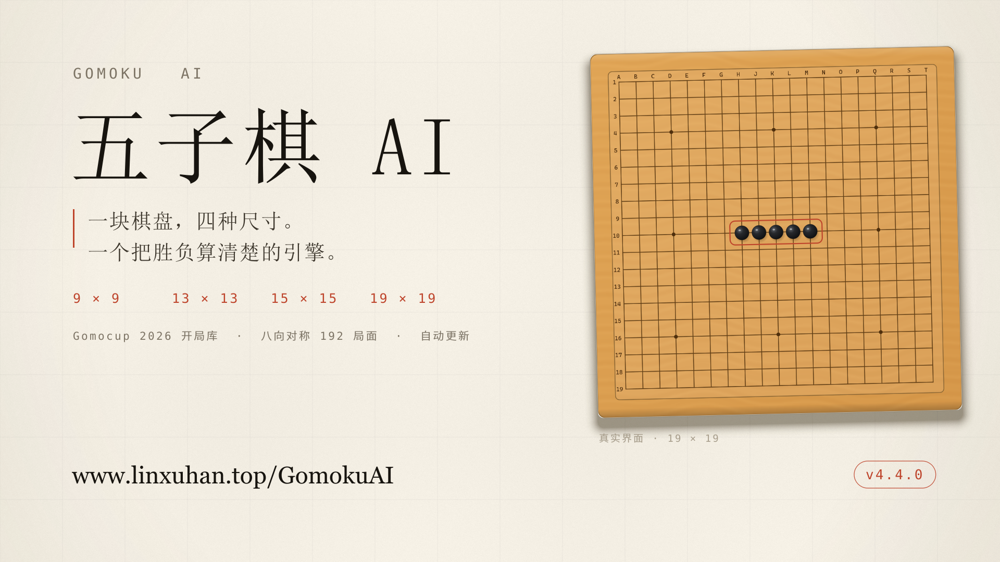
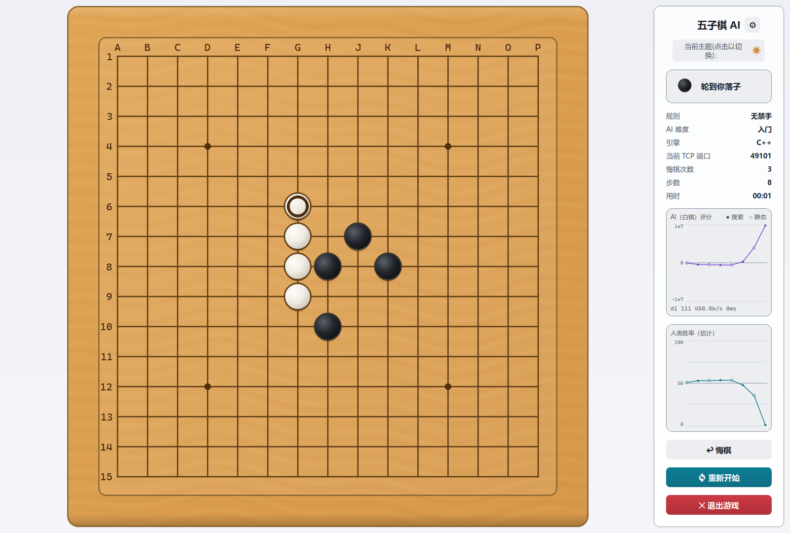
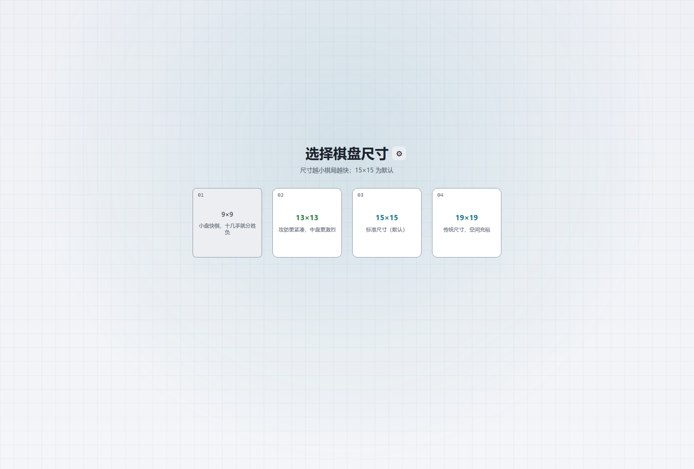
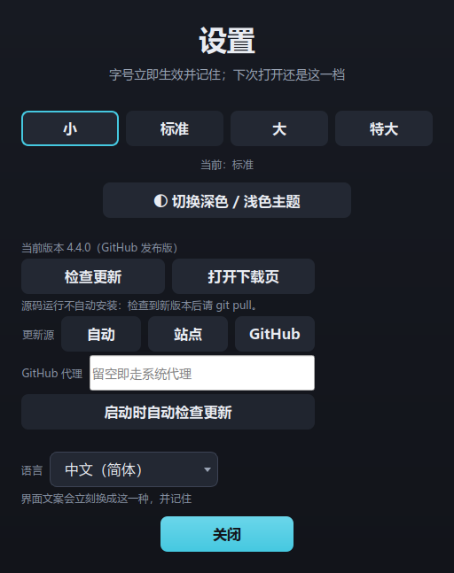

# 五子棋 AI · Gomoku AI

[简体中文](README.zh-CN.md) | **English**



A human-vs-AI Gomoku (five-in-a-row) program on **PyQt5**, with its search core
written in **C++17** and reached over a loopback socket. The engine is bitboard
based, with fully incremental evaluation, PVS + transposition table + quiescence
search, VCF, and the **Gomocup 2026 official opening book**. It runs on the CPU
only.

The board comes in **four sizes** — 9×9, 13×13, 15×15 (default) and 19×19 — and
there are **three ways to play**: against the AI, a two-player match at one
machine, or over the **LAN** against another copy of the program. Every finished
game can be re-computed move by move.

Windows and Linux builds are published with **automatic updates** verified by an
Ed25519 signature.


> **macOS users: this repository ships no macOS build** (it has never been
> developed or verified on macOS). For macOS, go to
> **[GomokuAI-Py](https://github.com/iamlinxuhan/GomokuAI-Py)** — the older
> pure-Python engine, which needs no platform-specific binary and therefore runs
> on macOS.

- **Board** — 9×9 / 13×13 / 15×15 (default) / 19×19, free or RIF ban rules
- **Difficulty** — six presets (Entry → Gomocup) plus a custom level
- **Modes** — AI, local two-player, LAN, plus a headless server
- **Platforms** — Windows 10/11, Linux (x86_64, aarch64, x32, armv7)
- **Tests** — 706 passing (non-perf), plus a headless UI suite and a 4-size ×
  3-path end-to-end run
- **Licence** — GPL-3.0-or-later

---

## What's new in v4.4.0

- **Board size is selectable.** 9/13/15/19, default **15×15**, across single
  player, local match, LAN, logs and review. On the C++ side each size is a
  separate compile, so no hot path gained a runtime branch.
- **The Gomocup 2026 official openings are in the book** — all 24 published
  lines, every prefix of each, expanded through the eight D4 symmetries at
  startup. A lookup is one hash at the root.
- **DFPN proof search** ships with the binary in two flavours, VCF-only and VCT.
  It is wired in parallel to the main search and **stays off by default**: the
  A/B gate was not met (details below).
- **Automatic updates** for the Windows installer, the Windows portable build and
  the Linux AppImage: `SHA256SUMS` + detached Ed25519 signature, draft releases
  that only go live after the offline signing step.
- **Linux ships AppImage**; the eight bare executables are gone. Logging is
  switched on with `--debug` or `GOMOKUAI_LOG=1` on any build.

---

## Screens

| In a game | Picking a size |
|---|---|
|  |  |

The side panel reports who computed each move (`C++` / `Python (local)` / `Book`),
the TCP port it landed on, and plots two curves: the raw engine score, and an
estimated human win rate derived from it. The latter is an estimate under the
engine's own model, not a calibrated probability.

---

## Features

### Engine

| Technique | Notes |
|---|---|
| **Bitboard** | 361-bit bitmap (sized per build) with fully incremental state: candidate set, neighbour counts, Zobrist hash, threat aggregation. `make`/`unmake` are strictly symmetric and support out-of-order undo |
| **Pattern classification** | Defined by set semantics: `F(S) = {empty e : playing at e makes five}`. `\|F\|≥2` is an open four, `\|F\|=1` a four. It counts winning points rather than introducing a vocabulary first |
| **Zero-sum evaluation** | `evaluate(pos, black) == -evaluate(pos, white)`, maintained incrementally |
| **Negamax + PVS** | Principal variation search with zero-window probes |
| **Transposition table** | Fixed-size array, age-based replacement, mate scores normalised on store/read. Levels 4/5 use a 2-way bucket (48 MiB) |
| **Quiescence search** | At leaf nodes only forced moves are searched, removing horizon misjudgements |
| **VCF** | Searches forced sequences where every move is a four. Three-state return (win / no win / could not finish). On at **every** level |
| **Move ordering** | History heuristic, killer moves, winning-point priority |
| **Time control** | Hard deadline + iterative deepening + aspiration windows + cooperative cancellation |
| **Opening book** | Gomocup 2026 lines with every prefix, expanded through D4, looked up once at the root; the small four-ply book still serves levels 1–2 |
| **DFPN** | Two proof-search modes (VCF-only, VCT) beside the main search; off by default |
| **Enhanced search** | LMR + forced-move extension, enabled for Advanced and Grandmaster |

### Interface

- **One design system.** Colours, sizes, spacing and radii come from `theme.py`;
  no colour literal appears in the UI (guarded by
  `tests/test_no_literal_colors.py`).
- **Cool chrome, warm board.** The interface is cool cyan, the board is the only
  warm surface. Wood grain is generated procedurally; stones are sprites with a
  highlight and a contact shadow.
- **Asynchronous AI.** Search runs on a QThread and can be cancelled mid-think.
- **Live readouts.** Turn, difficulty, engine, port, undo count, move count, and
  the two charts.
- **Optional RIF ban rules**, with forbidden points drawn as a geometric marker,
  explained on hover and confirmed before play.
- **Post-game review** for both colours in a local match, and for your own moves
  in an AI game or over the LAN.

---

## Install

### Release packages

Download from [Releases](https://github.com/iamlinxuhan/GomokuAI/releases). No
Python installation needed.

| Platform | Arch | File | How |
|---|---|---|---|
| Windows | `amd_x86_64` | `..._setup.exe` | Double-click; installs to `C:\Program Files\GomokuAI` (one UAC prompt) |
| Windows | `amd_x86_64` | `..._run_play.exe` | Standalone single file |
| Linux | `amd_x86_64` / `aarch64` | `GomokuAI_Linux_<arch>.AppImage` | `chmod +x`, then run; recommended |
| Linux | `amd_x86_64` / `amd_x32` | `..._setup.deb` | `sudo dpkg -i` → 「五子棋AI」 in the menu |
| Linux | `aarch64` / `armv7` | `..._setup.tar.gz` | Unpack, then `sudo ./install.sh` |

Match the arch segment with `uname -m`: `x86_64` → `amd_x86_64`, `i686` →
`amd_x32`, `aarch64` → `aarch64`, `armv7l` / `armv6l` → `armv7`.

The installers declare their graphics libraries, a CJK font candidate chain and
`hicolor-icon-theme`, and install the icon under `/usr/share/icons/hicolor/`, so
the app appears with its real icon in the menu. AppImages cannot declare
dependencies, and Release assets carry no file permissions:

```bash
chmod +x GomokuAI_Linux_amd_x86_64.AppImage
./GomokuAI_Linux_amd_x86_64.AppImage
```

**On Windows on ARM, take the x64 build.** Windows ships x64 emulation and it
runs fine. There is no native Windows ARM package: PyQt5 has no `win_arm64`
wheels across the entire series, so it cannot be built.

### Automatic updates

Three builds update themselves: the Windows installer, the Windows portable build
and the Linux AppImage. Settings has a "Check for updates" button, and the
program also checks silently 2.5 s after startup — a network failure shows
nothing. `.deb`, `.tar.gz` and MSIX are handled by their package managers; for
those, settings shows the version and a download link.



The trust root is an **Ed25519 signature**. The client fetches `SHA256SUMS` and
`SHA256SUMS.sig`, verifies the signature against the public key compiled into the
program, and only then checks the downloaded file against the hash. A missing
signature, a bad signature and a hash mismatch all refuse the install and leave
the current version untouched. The private key never leaves the maintainer's
machine: CI produces a **draft** release, and it only goes live after the
signature is uploaded offline.

Everything runs on CPU only. The installer and AppImage builds leave no files
besides the program itself; `game_log_*.txt` is written only with `--debug` or
`GOMOKUAI_LOG=1`. To choose a log directory:
`GOMOKU_AI_LOGDIR=/tmp/gomoku ./GomokuAI_Linux_amd_x86_64.AppImage`.

### From source

```bash
git clone https://github.com/iamlinxuhan/GomokuAI.git
cd GomokuAI
uv sync                              # Python >= 3.11; runtime deps are numpy + PyQt5
uv run python main.py
```

Dependencies are managed with **uv** (`pyproject.toml` + a committed `uv.lock`).
Without uv, `pip install numpy PyQt5` is exactly equivalent for running from
source.

---

## Rules and board sizes

1. Standard Gomoku on a **9×9 / 13×13 / 15×15 (default) / 19×19** board.
2. Black moves first; five in a row horizontally, vertically or diagonally wins.
3. Players alternate; a point cannot be played twice.

The size is chosen on a page between the rules page and the colours, and the
choice is remembered for the next game. 9×9 is for quick games, 13×13 is denser,
19×19 leaves room. A game started at one size stays there: the LAN protocol
carries the size in both `welcome` and `join`, and a mismatch is refused before
the first move instead of surfacing as two screens disagreeing about the board.

**Optional RIF ban rules.** Choosing **ban** binds **black only**: a double
three, a double four or an overline (six or more) loses on the spot. Exactly five
in a row still wins and outranks every foul, an overline included. White is never
restricted, and free play remains the default.

---

## Difficulty

The six presets are exactly `DIFFICULTY` in `engine.py`; the seventh level,
**Custom**, is configured in a dialog.

| Level | Time per move | Depth cap | Quiescence plies | VCF budget | Enhanced |
|---|---|---|---|---|---|
| **Entry** 入门 | 0.5 s | 2 | 2 | 0 s | — |
| **Novice** 初级 | 3 s | 4 | 4 | 0.3 s | — |
| **Intermediate** 中级 | 7 s | 10 | 8 | 0.5 s | — |
| **Advanced** 高级 | 15 s | 24 | 10 | 1.5 s | ✅ |
| **Grandmaster** 宗师 | 20 s | 24 | 12 | 3.0 s | ✅ |
| **Gomocup** | 300 s | 40 | 16 | 30 s | ✅ |
| **Custom** | 10–60 s | 2–40 | 2–24 | Off / Low / Mid / High / Max | On/Off |

Measured (`tools/bench.py --engine cpp --level N`, five fixed positions, 19×19):

| Level | Wall clock median / max | Depth median / max | nps median |
|---|---|---|---|
| Entry | 44 ms / 65 ms | 2 / 2 | 12,504 |
| Novice | 76 ms / 260 ms | 4 / 4 | 488,899 |
| Intermediate | 5,992 ms / 5,996 ms | 5 / 6 | 1,279,829 |
| Advanced | 8,640 ms / 12,792 ms | 6 / 9 | 977,729 |
| Grandmaster | 9,216 ms / 17,048 ms | 6 / 9 | 894,351 |

Some notes that the table does not show:

- **The depth cap is a cap, not a promise.** The depth actually reached is
  decided by iterative deepening inside the time limit.
- **Entry and Novice finish far inside their time** (44 ms / 76 ms) because their
  depth caps bind before the clock does. That is deliberate.
- **Gomocup reserves a fixed 20 s; every other level reserves 15% of its limit.**
  15% of 300 s would hold back 45 s, and the level is aligned with the 300 s
  per-move cap of the Gomocup finals, so the reserve is an absolute number. The
  hard deadline and the soft time manager go through the same `searchBudget()`.
- **VCF time counts inside the limit**, as part of it.
- **Every level has VCF on.** Novice once had it off, and with it off the level
  could not see an opponent's chain of fours — blindness, not a gentler game.
- **Only Entry carries a root attack bias**, applied at the root with a tolerance
  band. Novice and Intermediate carried the same band for a while and lost 25–35%
  and 0% (0–8) in same-level self-play, so it was measured and removed.

---

## Opening book

Two books ship, for two different purposes.

### The Gomocup 2026 book

`data/gomocup_2026.json` holds the **24 official openings published for Gomocup
2026** — 12 freestyle15, 12 standard — each with its full move sequence and a
reply computed by this project's own engine for the final position. The book is
generated by `tools/gen_gomocup_data.py` into two mirrors that must agree:

- `cpp/src/gomocup_book_data.h` for the C++ core,
- `GomokuAI/gomocup_book_data.py` for the Python engine.

**Every prefix is a key.** An opponent following a published line gets answered
move by move, from the second move on, instead of having to reach the line's end
first. Our own turn stores one move; the opponent's side is what branches, since
only the opponent can deviate.

**D4 expansion happens once, at startup.** Each prefix position is replayed in
its eight symmetries (four rotations, four mirrored rotations) and hashed, so a
position is recognised whatever orientation it arrives in. When two lines land on
the same key with different replies, the line with the smaller linear index wins;
the build prints the collision count once. Measured coverage after expansion:

| Size | Lines kept | Nodes | Table entries |
|---|---|---|---|
| 19×19 | 24 | 139 | 713 |
| 15×15 | 24 | 139 | 713 |
| 13×13 | 22 | 117 | 633 |
| 9×9 | 8 | 40 | 197 |

The 19×19 table is the same lines shifted by +2 from the centre; lines that would
run off a 13×13 or 9×9 board are dropped whole rather than squeezed.

**Where it fires, and where it does not:**

- **Only at the root**, never inside the tree, and **never on `analyze`** — a
  review asks for the score of every candidate move, which is a different
  question from "what does the book play".
- **Levels 3 and up.** Levels 1–2 keep the small four-ply book, which predates
  this work.
- **Never in the ban variant.** The official lines are published under free
  rules, and following one under RIF could walk black into a foul. The ban build
  ignores the flag and both sides of the parity suite agree.
- A hit reports `reason="开局库"`, `score=0`, `nodes=nps=0`, so the panel can
  explain an instant move.
- **The empty board still plays tengen** through `opening_move()`, bypassing the
  book. As black, only lines that open at tengen can be entered; the rest matter
  when the opponent follows a line.

### The small book (levels 1–2)

`opening_book.py` is generated by `tools/build_book.py` and holds the strongest
configuration's moves for the first four opening moves: 41 entries covering
positions with ≤3 stones on the board. The tree branches only on the opponent's
turn, because our own turn always plays the stored move.

There is exactly **one Python table and no C++ mirror** for this book. It is hit
inside `engine.py` before the request is sent, so a second copy could only drift.
A mismatch in hashing would present as "the book seems not to work", silently.

A hit returns with zero delay and its stored score, which is the true evaluation
at build time, so `nodes` is 0 while `best_val` is not. The cost is that low
levels show high readings on the win-rate chart for the first few opening moves.
Filling in 0 would be a lie instead.

The panel reports `Book` on the engine row. The three values — `C++`,
`Python (local)`, `Book` — describe three genuinely different execution paths.

---

## Two engines, one façade

```
┌─ Python (UI, PyQt5) ────────────┐        ┌─ C++17 ───────────────────┐
│  main.py                        │        │  gomoku_engine            │
│    └ RoomClient                 │        │   ├ Board (bitboard)      │
│         └ Room → AIPlayer       │  TCP   │   ├ evaluate (incremental)│
│              └ engine.ai_move()─┼───────►│   ├ search (PVS+TT+QS)    │
│              │                  │ JSON   │   ├ vcf (forced fours)    │
│              ├─ ok → C++ result │◄───────┤   └ dfpn (proof search)   │
│              └─ fail → silent ↓ │        └───────────────────────────┘
│  engine_local.py  (the old one) │
│    fallback + all light funcs   │
└─────────────────────────────────┘
```

**Only the search crosses TCP.** `ai_move` and `analyze` go over the socket;
`check_win`, `win_line`, `evaluate` and `opening_move` stay local because they run
synchronously on the UI thread, every stone.

**Difficulty parameters are sent by Python.** Each request carries
`time/max_depth/vcf_budget/qply` and the level's bias coefficient; the C++ side
hard-codes no difficulty table, so calibration needs no recompilation.

**The engine binary is a server.** The UI connects lazily through `engine.py`,
launches it when it cannot connect, and stops it via `atexit`. Ports come from a
pool of 15 per (variant, size), and each candidate must pass a `hello` check
before any search runs on it.

**Degradation is silent.** Server not built, failed to start, crashed, all ports
taken — every case means "this move used the local engine". The game continues,
no dialog is shown, one line goes to stderr, and the panel's `Engine` row reads
`Python (local)`. A book hit is not degradation and reports `Book`.

### The two engines' scales must agree

The C++ port follows Python's scoring scale and changes no constant. The win-rate
anchors in `analysis.py` are pinned to `LV_THREE_LIVE`, `BONUS_DOUBLE_FOUR` and
`STATIC_MAX`, verified by `tests/test_analysis.py::test_anchors_are_engine_constants`.
When the scales agree, the two charts are right by construction; when they
disagree, the charts are drawn wrong with no error anywhere. The client therefore
validates `board_size` / `win_score` / `static_max` during the handshake.

### Throughput

| Engine | Median nps (5 fixed midgames) |
|---|---|
| `engine_local.py` (Python + numpy) | 47,000 – 50,000 |
| `gomoku_engine` (C++17) | 0.6M – 3.3M |

Around **20–30×**. nps **decreases** as the level rises (about 430k at level 2,
940k at level 5) because higher levels use a larger `qply`: quiescence nodes are
much cheaper than main-search nodes, and mixing them into one denominator drags
nps down.

### A counter-intuitive pitfall: `_VCF_NODE_CAP`

Python's `_VCF_NODE_CAP = 120000` works out to about 2.4 seconds, more than the
highest level's VCF budget, so it essentially never triggers. In C++ 120k nodes
take about 0.05 s, so the same cap triggered on **every** level, classifying a
large number of provable mates as `EXHAUSTED` and making the C++ engine **weaker
at VCF than the Python one**. It is now `VCF_NODE_CAP` and sent with the request.

### Enhanced search (Advanced and Grandmaster)

Three `SearchConfig` fields carry it, all defaulting to 0: `enhanced`, `lmr`,
`extend`. With `enhanced == 0`, every path is bit-for-bit identical to before —
which is what keeps the C++↔Python parity suite and the pinned `--selftest`
moves valid.

Same time limit, five fixed positions, toggling only the flags:

| Position | Off | LMR only | Extension only | Both |
|---|---|---|---|---|
| `mid_10stones` | 1 | 1 | 1 | 1 |
| `mid_clash` | 5 | 5 | 5 | 5 |
| `spread_wide` | 5 | **6** | 5 | **6** |
| `dense_threat` | 6 | **9** | **8** | **9** |
| `sparse_early` | 6 | **8** | 6 | **8** |

LMR is the main lever. In a paired A/B at 6 s per move (30 games, colours
swapped), the enhanced arm won **21–9 (70%, p ≈ 0.02–0.035)**, and 14–1 as black.
6 s is the budget at which the treatment actually takes effect; 70% should not be
extrapolated to production levels of 15/20 s.

---

## DFPN

`cpp/src/dfpn.{h,cpp}` is a depth-first proof-number search with an arena: nodes
are allocated once (`nodeCap + 1`), the pointer is reset per search, and nodes are
never freed. It returns three states — `WIN`, `NO_WIN`, `UNKNOWN`. A node cap,
a timeout, a cancellation, a depth limit or a repeated line all return
`UNKNOWN`; only a fully resolved root returns a definite verdict.

Two move generators:

- **Mode 1, VCF-only.** Reuses the VCF move enumeration, which is complete for
  the four-threat space, so both `WIN` and `NO_WIN` are trustworthy.
- **Mode 2, VCT.** Threat-space search over fours and open threes. The attacker
  and defender sets must both be complete for a verdict; when either is
  incomplete the result degrades to `UNKNOWN`. A proven win inside the
  abstraction can still fail in the full game if the abstraction is incomplete,
  and the code is written so that incompleteness costs a verdict, never a
  false one.

When enabled, DFPN runs as a `std::thread` beside the main PVS search, with its
own board and arena, sharing only the read-only root position and the cancel
flag. A `WIN` is applied at the end of the current iteration; a faster or equally
fast mate already found by the main search is kept.

**The A/B gate was not met.** `tools/ab_proof.py`, five levels, 1.5 s per move,
32 self-play games and 9 fixed positions:

| Arm | Win rate | Takeovers | Moves differing from proof-off |
|---|---|---|---|
| Mode 1 (VCF-only) | 50.0% | 0 / 264 | 0 / 9 |
| Mode 2 (VCT) | 50.0% | 0 / 287 | 0 / 9 |

With no measured improvement, `proof_mode` stays 0 at all six levels. The code
remains reachable through explicit configuration.

---

## Review

When a game ends you pick a strength and the engine re-computes each move.
**Every move gets a row**: good ones marked green and labelled "optimal", the
rest as original point → best point + score difference, with a progress bar and a
cancel that keeps what was already computed. "Show position" displays the board as
it stood before that move, with the best point ringed and your actual move drawn
as a ghost stone.

What gets reviewed depends on the mode:

- against the AI, **your moves only**, at a strength no lower than the one played;
- in a **local two-player match, both colours**, each row prefixed with
  `【Black】` / `【White】`, and the strength page offers all six levels plus
  custom;
- **over the LAN, your own moves only**.

The review runs on its own thread and uses the rules the game was played with, so
a ban game goes through the ban engine. The opening move on an empty board and
any move whose search never completed are their own category — they were never
compared, and counting them as mistakes would be wrong.

---

## LAN play

Two copies of the program on the same network can play each other. It is the
third card on the mode screen and involves no AI. It is LAN only; crossing NAT is
not implemented.

The authoritative state lives in `session.py`, which holds no Qt and no sockets:
board, move list, win/draw, undo policy, review snapshots. The UI renders and
forwards intent. Single-player is a built-in room over an in-process transport, so
single-player and LAN take the same protocol path.

| Module | Role |
|---|---|
| `session.py` | The single source of truth for the rules |
| `players.py` | A seat is a `PlayerSpec`: `HumanLocal` or `AIPlayer` |
| `match.py` | Headless `Match`: alternating play, opening prefix, cooperative cancel |
| `ban_rules.py` | RIF ban predicates, pure functions of the position |
| `room.py` | One room = one `Session` + seats; an illegal move is re-asked, never fatal |
| `wire.py` | JSON + `\n` protocol, `PROTO_VERSION = 1`, two-way `hello` check |
| `server.py` | `RoomServer`: listen, room registry, lifecycle; default port **48900** |
| `client.py` | `RoomClient` (reader thread + `on_event`) and `LocalRoom` |

`RoomConfig` travels down with `welcome`, and its defaults are exactly
single-player behaviour. Undo across a network is a negotiation, and the game is
frozen while a proposal is pending. A headless server is available:

```bash
python server.py --port 48900 --room demo --black ai --white remote
```

Known limits: **disconnecting ends the game** (no reconnect or resume),
spectators are not implemented, and joining the dedicated server is not wired
into the UI.

---

## Engine design notes

**Mate scores and static scores are banded apart.** Static scores clamp to
±`STATIC_MAX`; mate scores start above `WIN_SCORE - MAX_PLY`, with a vacuum band
of 128 between them. The old engine's mate score overlapped its own composite
static range, so "dead in three" and "this looks bad" were numerically
indistinguishable.

**Time is the hard limit; the depth cap is a safety valve.** `think` sets a hard
deadline at `t0 + time × 0.85`, keeping 15% for the return trip and the UI.
`max_depth` exists to stop a quiet-looking midgame full of fours from dragging
even the low levels to 20 plies.

**The threat-response layer was deleted.** A 130-line heuristic layer answered
"what do I play now?" with seven rules. Its failure mode was structural: the time
saved when it was right was smaller than the game lost when it was wrong. The
quiescence search and VCF replace it with deterministic verdicts, and
`tests/test_threat.py` asserts that the heuristic names no longer exist while the
positions they handled still resolve correctly.

---

## Project layout

```
GomokuAI/
├── main.py            # UI assembly + game-flow wiring
├── session.py         # authoritative state machine (no Qt, no sockets)
├── players.py         # PlayerSpec: HumanLocal / AIPlayer
├── match.py           # headless Match
├── room.py            # one room = Session + seats + routing
├── server.py          # RoomServer / dedicated --server mode
├── wire.py            # JSON line protocol, hello handshake, error codes
├── client.py          # RoomClient + LocalRoom
├── engine.py          # engine façade: TCP client + silent degradation
├── engine_local.py    # Python engine: bitboard / eval / search / VCF
├── engine_ban.py      # ban variant of the Python engine
├── ban_rules.py       # RIF forbidden-point predicates
├── gomocup_book.py    # Gomocup 2026 book (generated data + D4 expansion)
├── opening_book.py    # small four-ply book (generated)
├── config.py          # binary lookup, port pools
├── cpp/               # C++17 compute core + wasm demo (cpp/web)
├── analysis.py        # score → win-rate conversion
├── charts.py          # the two panel charts
├── gamelog.py         # logs and coordinate format
├── theme.py           # design system
├── board_geometry.py  # pixel ↔ cell
├── board_render.py    # offscreen board rendering
├── updater.py         # auto-update: version.json → GitHub, Ed25519
├── ed25519.py         # RFC 8032, pure Python
├── tests/             # pytest
├── tools/             # bench / selfplay / arena / ui_e2e / ab_* / build_book
├── packaging/         # Linux packaging + AppImage
├── installer/         # Windows installer (Inno Setup, UTF-8 with BOM)
└── data/              # gomocup_2026.json
```

Build the C++ core:

```bash
cmake -S cpp -B cpp/build -DCMAKE_BUILD_TYPE=Release
cmake --build cpp/build -j
./cpp/build/gomoku_engine --selftest        # exit 0 = pass
```

Eight binaries are produced (19/15/13/9 × free/ban). Every build runs
`--verify-tables`, because an off-by-one in the 112-line numbering is the one
failure mode in this port that is silent.

---

## Tests

```bash
uv sync
uv run pytest -q                     # full suite
uv run pytest -q -m "not perf"       # what CI runs
uv run python tools/gui_smoke.py     # headless UI wiring
uv run python tools/ui_e2e.py        # 4 sizes × 3 paths, real click paths
```

**About the `perf` marker**: those thresholds read "nodes per second" or "what ply
in 3 seconds", so on a slower machine a regression and a slow machine look the
same. Correctness, incremental consistency, time compliance, the position suite,
VCF and pattern classification carry no marker.

Coverage runs from bitboard win detection and incremental diffing through
transposition entry types, mate normalisation, VCF's three states, difficulty
caps, cancellation latency, the review's candidate table, and the colour-literal
guard. The session and network layer is tested at socket level rather than
mocked, including a real two-client game over loopback. Ban rules carry their own
parity suite (predicates, session outcome, Python↔C++ agreement over hand-made
and seeded random positions, and a fork guard pinning `engine_ban` to
`engine_local` where no foul can occur).

Four board sizes are covered by `tests/test_board_sizes.py` and by the
`enhanced == 0` cross-language reconciliation, which runs at every size and
demands the same move and same score, character for character.

---

## Licence

**GNU General Public License, version 3 or later**; SPDX `GPL-3.0-or-later`.
Full text in [LICENSE](LICENSE).

```
Copyright (C) 2026 Lin Xuhan <2276677131@qq.com>
Copyright (C) 2026 YFY0109 <yfy0109@qq.com>
```

### Why GPLv3

The UI is built on **PyQt5**, released under GPLv3 (Riverbank offers GPLv3 or a
commercial licence). A binary that links it is covered by GPLv3 as a whole. The
previous GPL-2.0 text carried no "or later" clause, reading as GPL-2.0-only,
which is incompatible with a GPLv3 PyQt5.

### Third-party data

The Gomocup 2026 opening lines (`data/gomocup_2026.json` and its two generated
mirrors) transcribe the official coordinates published at
<https://live.gomocup.org/openings>; the replies stored for each line's final
position were computed by this project's own engine. Details in
[THIRD_PARTY_NOTICES.md](THIRD_PARTY_NOTICES.md). Everything else in this
repository is ours.

---

## Changelog

| Version | Date | Contents |
|---|---|---|
| **v4.4.2** | 2026-11-14 | **The update prompt got a progress window, and updates now use the system proxy.** Answering "yes" to "a new version is available" used to open Settings, where you had to press a second button and watch a percentage line; it now opens a download window with a real progress bar, verifies, installs, restarts and exits. The other half is why it was slow: on Linux the desktop keeps its proxy in gsettings or `kioslaverc`, while Python's urllib only reads environment variables, so the browser flew through the proxy while the updater crawled along a direct connection (4% of 37 MB in 30 seconds). `system_proxy()` now reads all three, the download mirror stops forcing a direct connection, a failed proxy falls back to direct once, and direct connections resolve **IPv4 first** — the same file measured 142 KB/s over IPv6 and 2.5 MB/s over IPv4 from this network, while browsers hide the difference with Happy Eyeballs. The same 37 MB file now downloads at 3 MB/s direct and 15 MB/s through the proxy. The startup check became a proper switch with a line underneath saying manual checks still work when it is off, plus a frequency picker (every launch / daily / weekly). |
| **v4.4.1** | 2026-11-14 | **The web version (Bilibili Toy) caught up with v4.4.0's board sizes, and a review can now be restarted at another strength.** 9/13/15/19 are selectable with **15×15** the default; each size is its own WASM build (`gomoku-<rules>-<n>.js`, eight files in all) and its own plaintext opening table, so the beginner opening still comes from the book at every size. LAN rooms carry the size in `state` and the joining side follows the host. A review started on the wrong strength used to have only "cancel", which shows the partial result and leaves you there; the desktop review screen **and** the web progress overlay now both carry **重选强度** (Change strength): it stops the run, drops the records already computed and goes back to the strength picker. Also fixed the WASM build, which stopped linking once v4.4.0's search began calling the opening book and DFPN. |
| **v4.4.0** | 2026-11-13 | **Four board sizes, the official opening book, self-updating, and AppImage on Linux.** Board size is selectable — 9/13/15/19, default **15×15**. On the C++ side each size is a separate compile (`-DGOMOKU_BOARD_SIZE`), eight binaries in all, so nothing in the hot path gained a branch; the pure-Python engine rebuilds its tables through `configure_size()`, and both paths derive Zobrist values from the same 19×19 table, so the `enhanced=0` reconciliation still holds at every size. The LAN protocol carries the size in `welcome` and `join`, and a mismatch is refused before the first move. **The Gomocup 2026 official openings** went in as all 24 published lines with every prefix position, so an opponent following a line is answered move by move; the eight D4 transforms are expanded once at startup into a `key → move` table, and a lookup is a single hash at the root only. 15×15 and 19×19 carry the whole book (713 entries), 13×13 keeps 22 lines (633), 9×9 keeps 8 (197). The book never fires in the ban variant. **DFPN proof search**, in VCF-only and VCT flavours, runs as a `std::thread` beside the main PVS search with its own board and arena. The A/B gate was not met — 32 self-play games and 9 positions at 1.5 s/move produced 50.0% and **0 takeovers** — so `proof_mode` stays 0 at all six levels. **Automatic updates** cover the Windows installer, the Windows portable build and the AppImage: the site's `version.json` first with the GitHub API as fallback, `SHA256SUMS` with a detached **Ed25519** signature, nothing installed before the signature verifies. CI now publishes a **draft** release that goes live only after the signature is uploaded offline. **Linux ships AppImage and the eight bare executables are gone**; logging is switched on with `--debug` or `GOMOKUAI_LOG=1` on any build. |
| **v4.3.1** | 2026-11-01 | **The Windows installer is now a machine-wide install.** It goes to `C:\Program Files\GomokuAI` and registers its uninstall entry under HKLM, at the cost of one UAC prompt. The reason is the Microsoft Store package checker: a per-user install writing the uninstall entry to HKCU is invisible to it, and its 'entry in Add or Remove Programs' and 'bundling' checks could only report that the app name and publisher were unidentified, surfacing as `PackageSet invalid`. `ArchitecturesAllowed=x64compatible` is set too. Nothing about the app changed: settings still go through QSettings (HKCU), and the installed build is the play variant, which writes no files beside the executable. |
| **v4.3.0** | 2026-10-30 | **Review is no longer exclusive to games against the AI, and there is a web version on Bilibili's Toy platform.** In a local two-player match every move by both colours is re-computed, each row prefixed with who played it; over the LAN only your own moves. A two-player match has no "strength of this game", so its review page copies the difficulty page — all six levels plus custom. **The review scores under the rules the game was played with**: `ReviewWorker` gained a `variant`, and a ban game goes through the ban engine. The web version compiles the same C++ search to WASM (`cpp/web`); `gm_think` hands back the evaluation table for every point at the root, and the engine runs in a Web Worker. It carries review and **online play**: Toy has no realtime channel, so a room code spells a public topic, `EventSource` receives and `fetch` publishes (ntfy). The host plays black and is authoritative; a visitor must be admitted to take the open seat, otherwise they watch read-only; undo is disabled online. |
| **v4.2.0** | 2026-10-25 | **A sixth level, "Gomocup": 300 seconds a move.** A new card follows "Grandmaster", with the per-move cap of the Gomocup finals, a depth ceiling of 40, a 30-second VCF budget and 16 plies of quiescence. **The time reserve became an absolute** (`SearchConfig.reserveSec`), because 15% of 300 seconds is 45 and this level keeps 20; the hard deadline and the soft-time prediction now both go through one `searchBudget()`. Local benchmarks spent their budget to the second (28.0/56.0/261.3 s) and depth grows slowly with the budget — roughly 3–4× the time per extra ply — so the search itself is the bottleneck. |
| **v4.1.0** | 2026-10-14 | **Optional RIF ban rules for black, enforced by a second C++ engine behind the same protocol.** Ban binds only black: a double three, a double four or an overline loses immediately, while exactly five in a row wins and outranks every foul. The rule set exists once, in `ban_rules.py`; the session consults it before placing the stone. The C++ side is the same sources built a second time — `ban.h` behind `#if GOMOKU_BAN` — so its search is untouched (a normalised disassembly diff shows an identical instruction stream). `hello` carries `rules`, `compute`/`analyze` validate it, and a new **`bancheck`** returns a position's forbidden points without searching, which is what makes the Python↔C++ reconciliation reproducible. Forbidden points are drawn as a geometric marker, never a character. |
| **v4.0.1** | 2026-10-07 | The language picker became one dropdown, and "follow system" is always written in the system language. The arrow is self-drawn in Python (QSS `::down-arrow` only accepts an image); the first version passed points to `drawPolygon` in a form that corrupted memory and crashed chart painting. |
| **v4.0.0** | 2026-10-06 | **Settings became a modal dialog, custom difficulty became sliders, and the UI now speaks six languages.** Keys are the Chinese source strings themselves; a missing entry falls back to Chinese. **Custom difficulty became sliders**: time 10–60 s, depth 2–40, quiescence 2–24 plies. Long-language clipping was fixed across cards, panel, review list, LAN screen and endgame overlay. |
| **v4.0.0** (architecture & LAN) | 2026-10-06 | **Three modes, one authoritative session behind all of them.** The mode screen gained **LAN play**: one player creates a room, the other joins by address. The game state machine was lifted into `Session` (no Qt, no sockets); `Player` abstracts a seat; a `Room` holds one `Session` plus its seats and owns the game thread. **Single-player became a built-in room**, so both modes run the same protocol path. The line protocol is JSON + newline with a two-way `hello` check and a hard version refusal; default port **48900**. `RoomConfig` travels with `welcome`. Undo across a network is a negotiation and freezes the game while pending. A headless server and a bot client are included. Reconnect, spectators and joining the dedicated server from the UI are still missing. |
| **v3.0.8** | 2026-10-03 | **Fixed: the Windows build silently fell back to the Python engine.** A PyInstaller bundle contains `VCRUNTIME140.dll` but not `MSVCP140.dll` at its root, while `gomoku_engine.exe` was built with `/MD` and imports it, so on a machine without the VC++ Redistributable the engine died at load. **The fix** links the MSVC runtime statically, and CI now scans the bytes of `gomoku_engine.exe` and fails if `MSVCP140.dll` is present. How to tell which engine a log came from: the `reason` column is useless (both write `PVS搜索`), so compare `val` + `dep`. |
| **v3.0.7** | 2026-10-03 | **The review screen now lists every move.** It used to show only non-optimal moves, but a review can run for minutes and "where did I play on move 9?" found nothing. The opening move and "the search never finished a round" are their own category and excluded from the improvable count. A tied optimum now rings the move you actually played. Also fixed a page leak that stacked one board widget tree per viewed move. |
| **v3.0.6** | 2026-10-03 | **Local two-player mode** and **post-game algorithmic review**, with the `analyze` protocol request carrying fields byte-identical to `compute`. Root candidates come from an `outRoot` out-parameter, and when `outRoot == nullptr` the entire old path is bit-for-bit unchanged. Getting a complete candidate table requires disabling the aspiration window while collecting. |
| **v3.0.5** | 2026-10-02 | Windows promoted to stable. Every platform gained `run_debug` / `run_play` with variants baked in at build time. Fixed the console window that popped up when launching the engine, gathered `__builtin_*` into `bitops.h` so MSVC could compile, and shipped per-size icons plus `setWindowIcon()` (a 256×256 ARGB image does not fit in one X request). |
| **v3.0.4** | 2026-10-01 | The endgame lights up the five first and settles afterwards, with a red line sweeping across it and the overlay delayed by one second. The theme toggle became its own row with self-drawn sun / moon glyphs. |
| **v3.0.3** | 2026-09-26 | Under the dark theme the strength bar takes its stone colour from the theme; the Grandmaster card compresses box spacing instead of shrinking stones. |
| v3.0.1 | 2026-09-25 | Port pool (fixed 8888 → 15 ports, each passing a `hello` check); two diagnostic values on the panel; artefact names split into family / bit-width / purpose; the release gate was rewritten. |
| v3.0.0 | 2026-09-25 | Search core replaced with C++17, difficulty expanded to five levels, LMR + forced-move extension + 2-way bucket TT for Advanced/Grandmaster; opening book added. |
| v2.0.2 | 2026-09-24 | Intermediate's time limit 5.0 s → 7.0 s. |
| v2.0.1 | 2026-09-24 | Fixed an evaluation symmetry issue and a board-coordinate format issue. |
| v2.0.0 | 2026-09-19 | **Complete rewrite**: evaluation and search replaced wholesale, UI rebuilt as a unified design system; the old layered threat response, multi-line defence, desperate mode and GPU branch were deleted. |
| v1.5 – v1.8.0 | — | Early versions. The old README's 166-line game analysis is in history: `git show d232fa7:README.md \| sed -n '236,401p'` |
