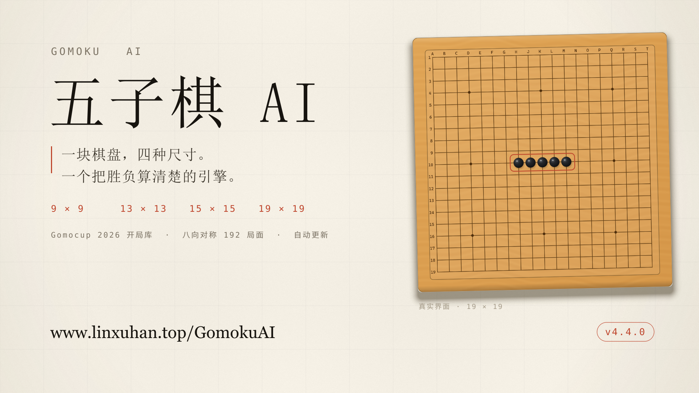
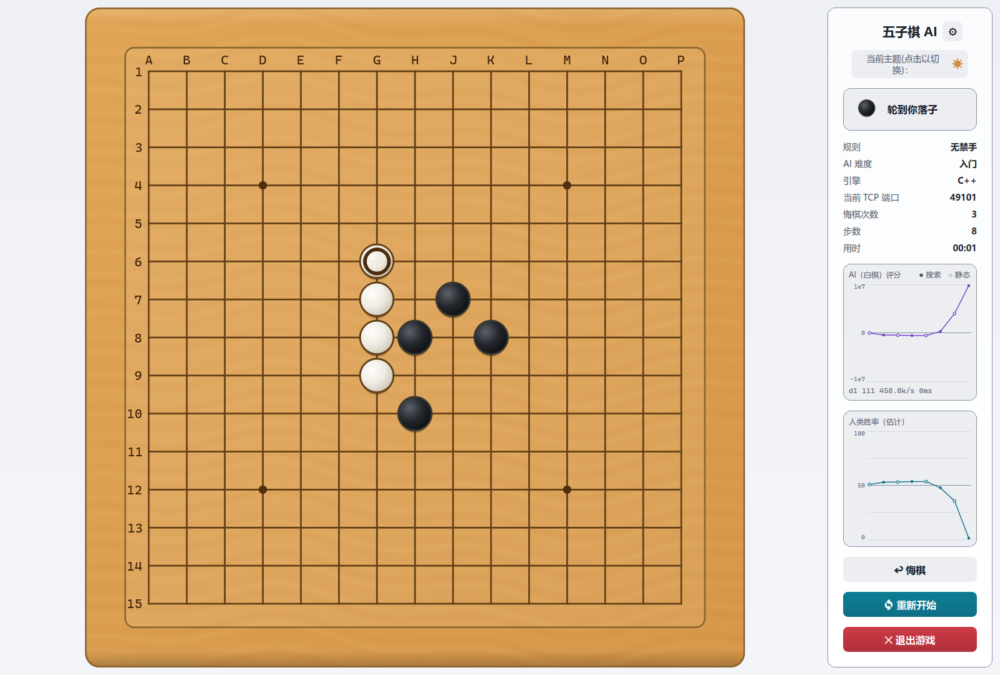
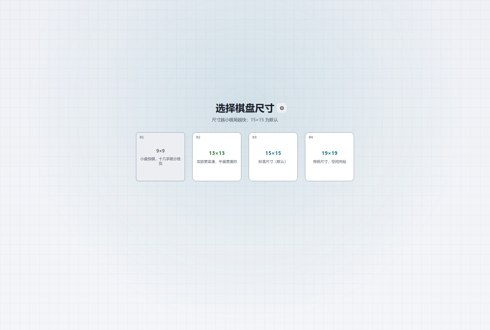
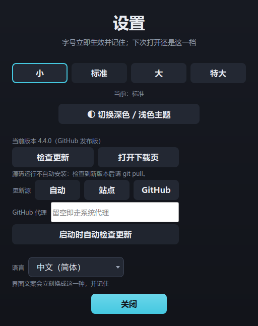

# 五子棋 AI

**简体中文** | [English](README.md)



基于 **PyQt5** 的五子棋人机对弈程序，搜索核心用 **C++17** 编写、通过本地
TCP 暴露给界面。引擎为位棋盘 + 全增量评估 + PVS + 置换表 + 静止搜索 + VCF，
并内置 **Gomocup 2026 官方开局库**。纯 CPU 运行。

棋盘有 **四种尺寸** —— 9×9、13×13、15×15（默认）、19×19；**三种对战方式**：
挑战 AI、同机双人对坐、**局域网联机**。终局之后每一手都能逐手重算。

Windows 与 Linux 提供正式安装包，**自动更新**以 Ed25519 签名作为信任根。


> **macOS 用户请注意：本仓库不提供 macOS 版**（从未在 macOS 上开发或验证过）。
> 要 macOS 版请前往 **[GomokuAI-Py](https://github.com/iamlinxuhan/GomokuAI-Py)**
> —— 那是纯 Python 引擎的旧版，不依赖平台专属的可执行文件，因此支持 macOS。

- **棋盘** —— 9×9 / 13×13 / 15×15（默认）/ 19×19，无禁手或 RIF 禁手
- **难度** —— 六档预设（入门 → Gomocup），外加自定义
- **玩法** —— 人机、本地双人、局域网，另有独立服务端
- **平台** —— Windows 10/11，Linux（x86_64、aarch64、x32、armv7）
- **测试** —— 706 项通过（非 perf），另有离屏 UI 套件与 4 尺寸 × 3 路径端到端
- **许可** —— GPL-3.0-or-later

---

## v4.4.0 新内容

- **棋盘尺寸可选。** 9/13/15/19，默认 **15×15**，单机、本地对战、联机、
  日志与复盘全线支持。C++ 侧每个尺寸单独编译一份，热路径没有多出运行期分支。
- **Gomocup 2026 官方开局进入开局库。** 24 条公布线全部收录，每条线的每一段
  前缀都是可查询节点，启动时按八种 D4 对称展开；查询是根节点上的一次哈希。
- **DFPN 证明搜索**随二进制发布，分「只走 VCF 走法」与「走 VCT 威胁空间」
  两种模式，与主搜索并行；**默认关闭** —— A/B 未达标，数据见下。
- **自动更新**覆盖 Windows 安装版、Windows 便携版与 Linux AppImage：
  `SHA256SUMS` 配分离式 Ed25519 签名，CI 只建 draft，离线签名后才上线。
- **Linux 改发 AppImage**，八个裸可执行文件取消；任何构建都能用 `--debug` 或
  `GOMOKUAI_LOG=1` 打开日志。

---

## 界面

| 对局中 | 选尺寸 |
|---|---|
|  |  |

右侧面板会写明每一步由谁算出来（`C++` / `Python (本地)` / `开局库`）、连在哪个
TCP 端口，并画出两条曲线：引擎原始评分，以及由它换算的人类胜率估计。胜率是
引擎模型下的估计值，不是统计标定的概率。

---

## 功能特性

### 引擎

| 技术 | 说明 |
|---|---|
| **位棋盘** | 按构建尺寸生成位图 + 全增量状态（候选集、邻居计数、Zobrist 哈希、威胁聚合）；`make`/`unmake` 严格对称，支持乱序撤销 |
| **棋型判定** | 按集合语义定义：`F(S) = {空点 e : 在 e 落子即成五}`，`\|F\|≥2` 即活四、`\|F\|=1` 即冲四。数成五点的个数，不需要先解释一套中间术语 |
| **零和评估** | `evaluate(局面, 黑) == -evaluate(局面, 白)`，增量维护、无不对称系数 |
| **Negamax + PVS** | Principal Variation Search，零窗口快速剪枝 |
| **置换表** | 定长数组 + 年龄淘汰；杀棋分按局面归一化存储（存 `value+ply`、取 `value-ply`）。高级/宗师用每桶 2 路（48 MiB） |
| **静止搜索** | 叶节点只搜强制着法，消除评估被地平线截断造成的误判 |
| **VCF** | 专找每一步都在冲四的强制序列；三态返回（胜 / 无胜 / 算不完）。**六档全开** |
| **走法排序** | 历史启发 + 杀手着法 + 成五点优先 |
| **时间控制** | 硬时间上限 + 迭代加深 + 志向窗口 + 协作式取消 |
| **开局库** | Gomocup 2026 全部前缀，按 D4 展开，根节点查一次；1–2 档仍用旧的前四手小库 |
| **DFPN** | 两种证明搜索（VCF-only、VCT）与主搜索并行；默认关闭 |
| **增强搜索** | LMR + 强制着法延伸，只对高级与宗师开启 |

### 界面

- **统一设计系统**：颜色、字号、间距、圆角各有单一来源（`theme.py`），界面里
  不出现硬编码颜色字面量（`tests/test_no_literal_colors.py` 守着）。
- **冷调界面 + 暖木棋盘**：界面走冷青，棋盘是全局唯一的暖色面。木纹程序化生成，
  棋子是带高光与接触投影的 sprite。
- **AI 异步计算**：搜索跑在 QThread 上，思考中途重开可以立即中断。
- **实时读数**：回合、难度、引擎、端口、悔棋次数、步数，外加两张图表。
- **可选 RIF 禁手**：禁手点画成几何标记，悬停有说明，落子前先确认。
- **战后复盘**：本地对战复盘黑白双方，人机与联机只复盘我方。

---

## 安装

### 发布包

从 [Releases](https://github.com/iamlinxuhan/GomokuAI/releases) 下载，不需要
安装 Python。

| 平台 | 架构 | 文件 | 用法 |
|---|---|---|---|
| Windows | `amd_x86_64` | `..._setup.exe` | 双击安装到 `C:\Program Files\GomokuAI`（一次 UAC） |
| Windows | `amd_x86_64` | `..._run_play.exe` | 单文件，免安装 |
| Linux | `amd_x86_64` / `aarch64` | `GomokuAI_Linux_<arch>.AppImage` | `chmod +x` 后直接运行，推荐 |
| Linux | `amd_x86_64` / `amd_x32` | `..._setup.deb` | `sudo dpkg -i`，菜单里出现「五子棋AI」 |
| Linux | `aarch64` / `armv7` | `..._setup.tar.gz` | 解包后 `sudo ./install.sh` |

架构段与 `uname -m` 对应：`x86_64` → `amd_x86_64`，`i686` → `amd_x32`，
`aarch64` → `aarch64`，`armv7l` / `armv6l` → `armv7`。

安装包在 `Depends:` 里声明了图形库、一套中日韩字体候选与 `hicolor-icon-theme`，
图标装到 `/usr/share/icons/hicolor/`，菜单里显示的是程序自己的图标。AppImage
无法声明依赖，且 Release 资产不带可执行位：

```bash
chmod +x GomokuAI_Linux_amd_x86_64.AppImage
./GomokuAI_Linux_amd_x86_64.AppImage
```

**Windows on ARM 请用 x64 包。** 系统自带 x64 仿真，运行正常。没有原生 Windows
ARM 包：PyQt5 整条产品线都没有 `win_arm64` wheel，编不出来。

### 自动更新

三种形态会自更新：Windows 安装版、Windows 便携版、Linux AppImage。设置里有
「检查更新」，程序启动 2.5 秒后也会静默检查一次（网络失败不弹任何东西）。
`.deb`、`.tar.gz` 与 MSIX 交给各自的包管理器；这几种在设置里只显示版本号与
下载链接。



信任根是 **Ed25519 签名**：客户端先取 `SHA256SUMS` 与 `SHA256SUMS.sig`，用编进
程序的公钥验签，通过之后才比对下载文件的哈希。缺签名、签名错、哈希不符三种
情况都拒绝安装，当前版本原样保留。私钥从不离开维护者的机器：CI 只建 **draft**
Release，离线把签名传上去之后才转正。

全程纯 CPU。安装版与 AppImage 不在磁盘上留任何文件；`game_log_*.txt` 只在
`--debug` 或 `GOMOKUAI_LOG=1` 时生成。要指定日志目录：

```bash
GOMOKU_AI_LOGDIR=/tmp/gomoku ./GomokuAI_Linux_amd_x86_64.AppImage
```

### 从源码运行

```bash
git clone https://github.com/iamlinxuhan/GomokuAI.git
cd GomokuAI
uv sync                              # Python >= 3.11；运行期依赖只有 numpy + PyQt5
uv run python main.py
```

依赖用 **uv** 管理（`pyproject.toml` + 提交在仓库里的 `uv.lock`）。不用 uv 时，
`pip install numpy PyQt5` 对源码运行完全等价。

---

## 规则与棋盘尺寸

1. 标准五子棋，棋盘为 **9×9 / 13×13 / 15×15（默认）/ 19×19**。
2. 黑先，横、竖、斜任一方向先成五者胜。
3. 双方轮流落子，一点不可重复落子。

尺寸在规则页与选色页之间选择，选择会被记住，下一局沿用。9×9 快棋，13×13 紧凑，
19×19 空间充裕。一局定在一个尺寸上：联机协议的 `welcome` 与 `join` 都带尺寸，
不一致会在开局前拒绝，避免两边对棋盘的理解不同却已开局。

**可选 RIF 禁手。** 选「禁手」后**只约束黑方**：三三、四四、长连（六子及以上）
立即判负。恰好五连仍然取胜，且优先于任何禁手，长连也不例外。白方不受任何限制，
无禁手仍是默认。

---

## 难度

六档预设就是 `engine.py` 里的 `DIFFICULTY`；第七档**自定义**在对话框里配。

| 档位 | 每手时限 | 深度上限 | 静止搜索层数 | VCF 预算 | 增强搜索 |
|---|---|---|---|---|---|
| **入门** | 0.5 s | 2 | 2 | 0 s | — |
| **初级** | 3 s | 4 | 4 | 0.3 s | — |
| **中级** | 7 s | 10 | 8 | 0.5 s | — |
| **高级** | 15 s | 24 | 10 | 1.5 s | ✅ |
| **宗师** | 20 s | 24 | 12 | 3.0 s | ✅ |
| **Gomocup** | 300 s | 40 | 16 | 30 s | ✅ |
| **自定义** | 10–60 s | 2–40 | 2–24 | 关/低/中/高/最高 | 开/关 |

实测（`tools/bench.py --engine cpp --level N`，五个固定局面，19×19）：

| 档位 | 实际耗时中位 / 最大 | 实际深度中位 / 最大 | nps 中位 |
|---|---|---|---|
| 入门 | 44 ms / 65 ms | 2 / 2 | 12,504 |
| 初级 | 76 ms / 260 ms | 4 / 4 | 488,899 |
| 中级 | 5,992 ms / 5,996 ms | 5 / 6 | 1,279,829 |
| 高级 | 8,640 ms / 12,792 ms | 6 / 9 | 977,729 |
| 宗师 | 9,216 ms / 17,048 ms | 6 / 9 | 894,351 |

表里看不出来的几件事：

- **深度上限是上限，不是承诺。** 实际搜到几层由迭代加深在时限内决定。
- **入门与初级远没用到自己的时间**（44 ms / 76 ms），深度上限先于时钟生效，
  这是有意为之。
- **Gomocup 档固定预留 20 s，其余档预留时限的 15%。** 按比例 300 s 要留 45 s，
  而这一档对齐 Gomocup 决赛的每手 300 s，预留必须是绝对数。硬截止与软时间管理
  走同一个 `searchBudget()`。
- **VCF 的时间算在时限内**，不额外加时。
- **六档全开 VCF。** 初级曾经关着，结果既算不出自己的连冲也看不见对手的连冲，
  那不是「难度更低」，是失明。
- **只有入门档带根节点进攻偏好**，在根上用容差带重排。初级与中级曾带同样的带，
  同档自对弈分别掉到 25–35% 与 0%（0–8），实测之后撤掉了。

---

## 开局库

仓库里有两种开局库，用途不同。

### Gomocup 2026 开局库

`data/gomocup_2026.json` 收录 **Gomocup 2026 公布的 24 条官方开局** —— freestyle15
与 standard 各 12 条 —— 每条含完整着法序列，以及本项目自己的引擎为最终局面算出
的应手。数据由 `tools/gen_gomocup_data.py` 生成两份镜像，必须逐项一致：

- `cpp/src/gomocup_book_data.h`，给 C++ 内核；
- `GomokuAI/gomocup_book_data.py`，给 Python 引擎。

**每一段前缀都是键。** 对手照着公布线走，我们从第二手起就能逐手应上，不必等
对方把整条线走完。我方回合只存一个着法，分支发生在对手一侧 —— 只有对手会偏离。

**D4 展开只在启动时做一次。** 每段前缀局面在八种对称下（四个旋转、四个镜像旋转）
各重放一次并求哈希，同一个局面无论以哪种朝向出现都能认出来。两条线落到同一个键
而应手不同时，取线性格索引更小的那条；构建时把冲突数打印一次。展开后实测覆盖：

| 尺寸 | 保留线数 | 节点数 | 表条目 |
|---|---|---|---|
| 19×19 | 24 | 139 | 713 |
| 15×15 | 24 | 139 | 713 |
| 13×13 | 22 | 117 | 633 |
| 9×9 | 8 | 40 | 197 |

19×19 的表是把同样的线以盘心为基准整体偏移 +2；在 13×13 或 9×9 上会出界的线
整条丢弃，不做缩放。

**什么时候会命中，什么时候不会：**

- **只在根节点查**，不进搜索树；**`analyze` 从不查** —— 复盘要的是每个候选点的
  分值，和「开局库走哪」是两个问题。
- **3 档及以上**启用；1–2 档仍用旧的前四手小库。
- **禁手变体永不启用。** 官方线按无禁手口径公布，套到 RIF 上可能让黑方走出禁手。
  禁手二进制直接忽略该开关，两边对拍一致。
- 命中时报 `reason="开局库"`、`score=0`、`nodes=nps=0`，面板能解释这次瞬发。
- **空盘仍走天元**，经 `opening_move()`，不经开局库。作为黑方，只有天元开局的
  官方线能进入；其余线在对手照线走的时候生效。

### 前四手小库（1–2 档）

`opening_book.py` 由 `tools/build_book.py` 生成，存最强配置在开局前四手的最优
着法：41 项，覆盖盘上 ≤3 子的局面。树只在对手回合分支，因为我方回合总是直接
走表里的着法。

这本库**只有 Python 一份，C++ 没有镜像**。它在 `engine.py` 里、请求发出之前就
命中；第二份表唯一的效果是能漂移，而哈希一旦对不上，症状是「开局库好像不工作」，
全程没有报错。

命中时零延迟返回表里存的分数，那是构建时的真实评估值，所以 `nodes` 为 0 而
`best_val` 不是。代价是低档在开局前几手的胜率图上会显示高水平读数；填 0 才是
撒谎。

面板的引擎行报 `开局库`。`C++`、`Python (本地)`、`开局库` 三个值对应三条确实
不同的执行路径。

---

## 两个引擎，一层门面

```
┌─ Python（界面，PyQt5）──────────┐        ┌─ C++17 ───────────────────┐
│  main.py                        │        │  gomoku_engine            │
│    └ RoomClient                 │        │   ├ Board（位棋盘）       │
│         └ Room → AIPlayer       │  TCP   │   ├ evaluate（增量）      │
│              └ engine.ai_move()─┼───────►│   ├ search（PVS+TT+QS）   │
│              │                  │ JSON   │   ├ vcf（连续冲四）       │
│              ├─ 成功 → C++ 结果 │◄───────┤   └ dfpn（证明搜索）      │
│              └─ 失败 → 静默降级 │        └───────────────────────────┘
│  engine_local.py（旧实现）      │
│    兜底 + 全部轻量函数          │
└─────────────────────────────────┘
```

**只有搜索走 TCP。** `ai_move` 与 `analyze` 过套接字；`check_win`、`win_line`、
`evaluate`、`opening_move` 留在本地，因为它们每落一子都在 UI 主线程同步跑一次。

**难度参数由 Python 下发。** 每个请求带 `time/max_depth/vcf_budget/qply` 与本档的
偏好系数，C++ 侧不写死难度表，标定参数不需要重新编译。

**引擎二进制是一个服务端。** 界面经 `engine.py` 懒连接，连不上就自己拉起，退出时
`atexit` 关掉。端口按 (变体, 尺寸) 各有一段 15 个的池，每个候选端口先过 `hello`
校验，再跑任何搜索。

**降级是静默的。** 没编译、起不来、崩溃、端口全被占 —— 一律翻译成「这一手用了
本地引擎」，棋局继续，不弹窗、不抛异常，只有一行原因进 stderr，面板的引擎行变成
`Python (本地)`。开局库命中不算降级，报 `开局库`。

### 两个引擎的分值刻度必须一致

C++ 移植沿用 Python 的评分刻度，一个常数都没改。`analysis.py` 的胜率锚点直接钉在
`LV_THREE_LIVE`、`BONUS_DOUBLE_FOUR`、`STATIC_MAX` 上，由
`tests/test_analysis.py::test_anchors_are_engine_constants` 逐项校验。刻度一致，
两张图按构造成立；刻度不一致，图会画错而不报错。客户端因此在握手时校验
`board_size` / `win_score` / `static_max`。

### 实测吞吐

| 引擎 | nps 中位（五个固定中局） |
|---|---|
| `engine_local.py`（Python + numpy） | 47,000 – 50,000 |
| `gomoku_engine`（C++17） | 0.6M – 3.3M |

约 **20–30 倍**。nps 随档位升高而**下降**（2 档约 43 万，5 档约 94 万），原因不在
退化：高档的 `qply` 更大，静止搜索占比升到 40%–90%，而静止搜索节点便宜得多，
混进同一个分母就会把 nps 拉低。

### 一个反直觉的坑：`_VCF_NODE_CAP`

Python 的 `_VCF_NODE_CAP = 120000` 折合约 2.4 秒，高于最高档的 VCF 预算，实际上
几乎不会触发。C++ 里 12 万节点约 0.05 秒，同一个上限**每一档都会触发**，大量可
证明的杀棋被判成 `EXHAUSTED`，结果是 **C++ 的 VCF 比 Python 更弱**。现在它叫
`VCF_NODE_CAP`，随请求下发。

### 增强搜索（高级与宗师）

对应三个 `SearchConfig` 字段，默认全为 0：`enhanced`、`lmr`、`extend`。
`enhanced == 0` 时每条路径与改动前逐位相同 —— C++↔Python 对拍与 `--selftest`
里钉住的着法因此继续成立。

同样时限、五个固定局面，只切换开关：

| 局面 | 关 | 只开 LMR | 只开延伸 | 两个都开 |
|---|---|---|---|---|
| `mid_10stones` | 1 | 1 | 1 | 1 |
| `mid_clash` | 5 | 5 | 5 | 5 |
| `spread_wide` | 5 | **6** | 5 | **6** |
| `dense_threat` | 6 | **9** | **8** | **9** |
| `sparse_early` | 6 | **8** | 6 | **8** |

主力是 LMR。在每手 6 秒、30 局、双方交换执色的配对 A/B 里，增强方
**21–9（70%，p ≈ 0.02–0.035）**，执黑 14–1。6 秒是这套改动真正生效的预算，
70% 不能外推到 15/20 秒的生产档。

---

## DFPN

`cpp/src/dfpn.{h,cpp}` 是深度优先的证明数搜索，用 arena：节点一次分配
（`nodeCap + 1`），每次搜索只重置指针，节点不逐个释放。返回三态 —— `WIN`、
`NO_WIN`、`UNKNOWN`。节点上限、超时、取消、深度上限、路径重复，任一触发都是
`UNKNOWN`；只有根节点被完全解出才给确定值。

两套走法生成：

- **模式 1，VCF-only。** 复用 VCF 的走法枚举，在冲四空间里是完整的，所以 `WIN`
  与 `NO_WIN` 都可信。
- **模式 2，VCT。** 在冲四与活三的威胁空间里搜。攻守两边的集合都必须完整才能给
  结论；任一边不完整，结果一律降级为 `UNKNOWN`。抽象内证明的胜利在完整棋局里
  仍可能失败，代码的写法让「抽象不完整」只换来一个「不知道」，不会换来一个假答案。

启用时，DFPN 作为 `std::thread` 与主 PVS 并行，自带棋盘与 arena，只共享只读的
起始局面与取消标志。`WIN` 在本轮迭代结束时落地；主搜索若已找到同分或更快的杀棋，
保留主搜索结果。

**A/B 没有过闸。** `tools/ab_proof.py`，五档、1.5 秒/手、32 局自对弈 + 9 个固定
局面：

| 实验臂 | 胜率 | 接管次数 | 与关掉时不同的着法 |
|---|---|---|---|
| 模式 1（VCF-only） | 50.0% | 0 / 264 | 0 / 9 |
| 模式 2（VCT） | 50.0% | 0 / 287 | 0 / 9 |

没有测到提升，`proof_mode` 在六档上保持 0。代码保留，只在显式配置时可开。

---

## 复盘

终局后挑一个强度，引擎逐手重算。**每一手都列出来**：走对的标绿写「最优」，走错的
写原坐标 → 最优点 + 分值差，带进度条与取消（取消后保留已算完的部分）。点「棋局
显示」摆的是该手落子之前的局面：最优点画环，自己走的那手画成幽灵子，两者在同一
张盘上对照。

复盘对象按玩法区分：

- 人机：**只算玩家**的每一手，强度不低于本局难度；
- 本地双人：**黑白双方每一手**，行首标 `【黑方】` / `【白方】`，强度页给全部六档
  加自定义；
- 联机：**只算我方**，对手的棋不进列表。

复盘跑在后台线程，规则用本局那一套 —— 禁手局走禁手引擎。空盘首手与「搜索没跑完
一轮」的手是单独一类：它们从未被比较，算成失误是不对的。

---

## 局域网联机

同一网络里的两份程序可以互相对弈。它是模式页的第三张卡，完全不涉及 AI。只支持
局域网，不穿越 NAT。

权威状态在 `session.py` 里，不含 Qt、不含套接字：棋盘、着法列表、胜负、悔棋策略、
复盘快照都在那里。界面只负责绘制与转发意图。单机被改造成一个内置房间，走进程内
传输，所以单机与联机走同一条协议路径。

| 模块 | 职责 |
|---|---|
| `session.py` | 规则唯一真源 |
| `players.py` | 座位即 `PlayerSpec`：`HumanLocal` 或 `AIPlayer` |
| `match.py` | 无界面 `Match`：交替落子、开局前缀、协作取消 |
| `ban_rules.py` | RIF 禁手判定，局面的纯函数 |
| `room.py` | 一个房间 = 一个 `Session` + 座位；非法着法回错误并重问，不终局 |
| `wire.py` | JSON + 换行协议，`PROTO_VERSION = 1`，双向 `hello` 校验 |
| `server.py` | `RoomServer`：监听、房间注册、连接生命周期；默认端口 **48900** |
| `client.py` | `RoomClient`（读线程 + 回调）与 `LocalRoom` |

`RoomConfig` 随 `welcome` 下发，默认值就是单机行为。跨网络的悔棋是一次协商，
协商挂起期间棋局冻结。也可以跑无界面服务端：

```bash
python server.py --port 48900 --room demo --black ai --white remote
```

已知限制：**断线即终局**（没有重连/续局），没有旁观，服务端也没有接进 UI 的房间
列表。

---

## 引擎设计札记

**杀棋分与静态分分带。** 静态分夹在 ±`STATIC_MAX` 内，杀棋分从
`WIN_SCORE - MAX_PLY` 起算，中间留 128 的空带。旧引擎的杀棋分与它自己的复合静态
分区间重叠，「三步内必死」和「这局面有点糟」在数值上分不开。

**时间是硬上限，深度上限是安全阀。** `think` 把硬截止定在 `t0 + time × 0.85`，
留 15% 给回程与界面；`max_depth` 的作用是防止一个「看起来很安静、其实满盘冲四」
的中局把低档也拖到 20 层。

**威胁响应层已删除。** 旧版在搜索之前有一层约 130 行的启发式，用七条规则回答
「现在该下哪」。它的失效方式是结构性的：判对时省下的时间，远小于判错时输掉的棋。
静止搜索与 VCF 用确定性判定替代它，`tests/test_threat.py` 断言那些启发式名字不再
存在，而它们当年处理的局面依然解得对。

---

## 项目结构

```
GomokuAI/
├── main.py            # 界面装配 + 流程接线
├── session.py         # 权威状态机（无 Qt、无套接字）
├── players.py         # PlayerSpec：HumanLocal / AIPlayer
├── match.py           # 无界面 Match
├── room.py            # 房间 = Session + 座位 + 消息路由
├── server.py          # RoomServer / --server 独立模式
├── wire.py            # JSON 行协议、hello 握手、错误码
├── client.py          # RoomClient + LocalRoom
├── engine.py          # 引擎门面：TCP 客户端 + 静默降级
├── engine_local.py    # Python 引擎：位棋盘 / 评估 / 搜索 / VCF
├── engine_ban.py      # Python 引擎的禁手变体
├── ban_rules.py       # RIF 禁手判定
├── gomocup_book.py    # Gomocup 2026 开局库（数据 + D4 展开）
├── opening_book.py    # 前四手小库（生成文件）
├── config.py          # 二进制查找、端口池
├── cpp/               # C++17 计算内核 + wasm demo（cpp/web）
├── analysis.py        # 分值 → 胜率换算
├── charts.py          # 面板上的两张图
├── gamelog.py         # 日志与坐标格式
├── theme.py           # 设计系统
├── board_geometry.py  # 像素 ↔ 格点
├── board_render.py    # 离屏棋盘渲染
├── updater.py         # 自动更新：version.json → GitHub，Ed25519
├── ed25519.py         # RFC 8032，纯 Python
├── tests/             # pytest
├── tools/             # bench / selfplay / arena / ui_e2e / ab_* / build_book
├── packaging/         # Linux 打包与 AppImage
├── installer/         # Windows 安装脚本（Inno Setup，UTF-8 带 BOM）
└── data/              # gomocup_2026.json
```

构建 C++ 内核：

```bash
cmake -S cpp -B cpp/build -DCMAKE_BUILD_TYPE=Release
cmake --build cpp/build -j
./cpp/build/gomoku_engine --selftest        # 退出码 0 即通过
```

一共产出八个二进制（19/15/13/9 × 无禁手/禁手）。每次构建都会跑
`--verify-tables`：112 行编号差一是这次移植里唯一会静默失败的环节。

---

## 测试

```bash
uv sync
uv run pytest -q                     # 全量
uv run pytest -q -m "not perf"       # CI 跑的就是这一条
uv run python tools/gui_smoke.py     # 离屏 UI 接线
uv run python tools/ui_e2e.py        # 4 尺寸 × 3 路径，走真实点击路径
```

**关于 `perf` 标记**：这些阈值读的是「每秒节点数」或「3 秒内搜到第几层」，慢机器
上的退化和慢机器本身读数一样。正确性、增量一致性、时限合规、局面套件、VCF 与
棋型判定不带标记。

覆盖范围从位棋盘成五检测、增量差分，到置换表条目类型、杀棋分归一、VCF 三态、
难度上限、取消延迟、复盘的候选表、颜色字面量守门。会话与网络层按套接字级测试，
不做 mock，包括一次真实的双客户端回环对局。禁手规则有自己的对拍套件（判定、
会话结果、手工与定种子随机局面上的 Python↔C++ 一致，以及把 `engine_ban` 钉在
`engine_local` 上的分叉护栏）。

四个尺寸由 `tests/test_board_sizes.py` 与 `enhanced == 0` 的跨语言对拍共同覆盖，
后者在每个尺寸上都要求同着、同分、逐字一致。

---

## 许可

**GNU General Public License, version 3 or later**，SPDX 标识
`GPL-3.0-or-later`。全文见 [LICENSE](LICENSE)。

```
Copyright (C) 2026 Lin Xuhan <2276677131@qq.com>
Copyright (C) 2026 YFY0109 <yfy0109@qq.com>
```

### 为什么是 GPLv3

界面基于 **PyQt5**，它本身是 GPLv3（Riverbank 只提供 GPLv3 或商业许可）。链接它的
二进制整体已被 GPLv3 覆盖。仓库原先的 GPL-2.0 文本没有 "or later" 条款，读法是
GPL-2.0-only，与 GPLv3 的 PyQt5 不兼容。

### 第三方数据

Gomocup 2026 开局线（`data/gomocup_2026.json` 及其两份生成镜像）转写自
<https://live.gomocup.org/openings> 公布的官方坐标；每条线最终局面的应手由本项目
自己的引擎算出。细节见 [THIRD_PARTY_NOTICES.md](THIRD_PARTY_NOTICES.md)。仓库里
其余内容都是本项目自己的。

---

## 更新日志

| 版本 | 日期 | 内容 |
|---|---|---|
| **v4.4.1** | 2026-11-14 | **网页版（B 站 Toy）补上 v4.4.0 的棋盘尺寸，复盘也可以换一档强度重来。** 9/13/15/19 可选，默认 **15×15**；每个尺寸单独编一份 wasm（`gomoku-<规则>-<n>.js`，共八份）与单独一张明文开局库，入门档在每个尺寸上都能查到库里的应手。联机 `state` 带尺寸，加入方跟随房主。原来复盘强度选错只剩「取消」，只能看半截结果；进度遮罩新增 **「重选强度」**，停掉本轮、丢掉已算记录、退回强度页。顺带修好 wasm 构建：v4.4.0 的搜索开始引用开局库与 DFPN 之后，网页版一直链接失败。 |
| **v4.4.0** | 2026-11-13 | **四种棋盘尺寸、官方开局库、自动更新、Linux 改发 AppImage。** 棋盘尺寸可选 —— 9/13/15/19，默认 **15×15**。C++ 侧每个尺寸单独编译（`-DGOMOKU_BOARD_SIZE`），共八个二进制，热路径没有多出分支；纯 Python 引擎经 `configure_size()` 重建全部表，两条路径的 Zobrist 都取自同一张 19×19 表，所以 `enhanced=0` 的逐字对拍在每个尺寸上都成立。联机协议的 `welcome` 与 `join` 都带尺寸，不一致在开局前拒绝。**Gomocup 2026 官方开局**以 24 条公布线连同每一段前缀入库，对手照线走就逐手应上；八种 D4 对称在启动时展开成一张 `key → move` 表，查询只在根节点做一次哈希。15×15 与 19×19 是全量（713 条），13×13 保留 22 条（633），9×9 保留 8 条（197）。禁手变体永不启用开局库。**DFPN 证明搜索**分 VCF-only 与 VCT 两版，作为 `std::thread` 与主 PVS 并行，自带棋盘与 arena。A/B 没有过闸 —— 1.5 秒/手、32 局自对弈 + 9 个局面，胜率 50.0%，接管 **0 次** —— 所以 `proof_mode` 六档全为 0。**自动更新**覆盖 Windows 安装版、Windows 便携版与 AppImage：先问站点 `version.json`，回退 GitHub API；`SHA256SUMS` 配分离式 **Ed25519** 签名，验签不过不安装。CI 只建 **draft** Release，离线传签名之后才转正。**Linux 改发 AppImage，八个裸可执行文件取消**；任何构建都能用 `--debug` 或 `GOMOKUAI_LOG=1` 打开日志。 |
| **v4.3.1** | 2026-11-01 | **Windows 安装包改为全机安装。** 装到 `C:\Program Files\GomokuAI`，卸载项写 HKLM，代价是安装时一次 UAC。原因是 Microsoft Store 的包检查器：按用户安装把卸载项写进 HKCU，它看不见，「程序列表里有条目」「捆绑」两项检查只能报应用名与发行者无法识别，表现为 `PackageSet invalid`。同时设了 `ArchitecturesAllowed=x64compatible`。程序本身没变：设置仍走 QSettings（HKCU），安装的是 play 变体，不在可执行文件旁写任何文件。 |
| **v4.3.0** | 2026-10-30 | **复盘不再局限于人机对局，并上线 B 站 Toy 平台的网页版。** 本地双人局黑白双方的每一手都重算，行首标出是谁下的；联机只算我方。双人局没有「本局难度」，强度页照搬难度页 —— 六档加自定义。**复盘按本局规则评分**：`ReviewWorker` 新增 `variant`，禁手局走禁手引擎。网页版把同一套 C++ 搜索编成 WASM（`cpp/web`），`gm_think` 返回根节点每个点的评估表，引擎跑在 Web Worker 里。它带复盘与**联机**：Toy 没有实时通道，房间码拼成一个公开 topic，`EventSource` 收、`fetch` 发（ntfy）。房主执黑且是权威方；访客要经房主放行才能入座，否则只读观战；联机禁用悔棋。 |
| **v4.2.0** | 2026-10-25 | **第六档「Gomocup」：每手 300 秒。** 卡片排在「宗师」之后，对齐 Gomocup 决赛的每手上限，深度天花板提到 40、VCF 预算 30 秒、静止搜索 16 层。**时间预留从比例改为绝对量**（`SearchConfig.reserveSec`）：300 秒的 15% 是 45，这一档只留 20；硬截止与软时间预测现在都走同一个 `searchBudget()`。本地基准把预算用到秒（28.0/56.0/261.3 s），深度随预算增长很慢 —— 每多一层约需 3–4 倍时间 —— 瓶颈在搜索本身。 |
| **v4.1.0** | 2026-10-14 | **可选 RIF 禁手规则，由同一套协议背后的第二个 C++ 引擎执行。** 禁手只约束黑方：三三、四四、长连立即判负，恰好五连取胜且优先于任何禁手。规则只写一处（`ban_rules.py`），会话在落子前询问。C++ 侧是同一份源码再编一次 —— `ban.h` 藏在 `#if GOMOKU_BAN` 后面 —— 搜索未被改动（归一化后的反汇编对比显示指令流一致）。`hello` 带 `rules`，`compute`/`analyze` 校验它；新增 **`bancheck`** 在不搜索的情况下返回禁手点，这也是 Python↔C++ 对拍能够可复现的原因。禁手点画成几何标记，不用字符。 |
| **v4.0.1** | 2026-10-07 | 语言选择器改成单个下拉框，「跟随系统」始终用系统语言书写。箭头用 Python 自绘（QSS 的 `::down-arrow` 只接受图片）；第一版把点集以错误的形式传给 `drawPolygon`，内存被破坏，之后画图时崩溃。 |
| **v4.0.0** | 2026-10-06 | **设置改为模态对话框，自定义难度改为滑杆，界面支持六种语言。** 键就是中文字符串本身，缺条目回落到中文。**自定义难度改成滑杆**：时间 10–60 秒、深度 2–40、静止搜索 2–24 层。长语言下的截断在卡片、面板、复盘列表、联机页与终局浮层上统一修掉。 |
| **v4.0.0**（架构与联机） | 2026-10-06 | **三种模式，背后同一个权威会话。** 模式页新增**局域网联机**：一方建房，另一方输地址加入。游戏状态机从界面里提出去放进 `Session`（无 Qt、无套接字）；`Player` 抽象座位；`Room` 持有一个 `Session` 加座位并拥有游戏线程。**单机被改造成内置房间**，两种玩法走同一条协议路径。行协议是 JSON + 换行，双向 `hello` 校验，版本不符直接拒绝；默认端口 **48900**。`RoomConfig` 随 `welcome` 下发。跨网络悔棋是协商，挂起期间棋局冻结。附带无界面服务端与机器人客户端。重连、旁观、从 UI 加入独立服务端仍未实现。 |
| **v3.0.8** | 2026-10-03 | **修复：Windows 版静默降级到 Python 引擎。** PyInstaller 包的根目录里有 `VCRUNTIME140.dll` 却没有 `MSVCP140.dll`，而 `gomoku_engine.exe` 用 `/MD` 编译、导入它，在没有 VC++ 运行库的机器上引擎一加载就死。**修法**是静态链接 MSVC 运行库，同时 CI 扫描 `gomoku_engine.exe` 的字节，出现 `MSVCP140.dll` 即失败。判断日志来自哪个引擎：`reason` 列没用（两边都写 `PVS搜索`），看 `val` + `dep`。 |
| **v3.0.7** | 2026-10-03 | **复盘列表列出每一手。** 原先只列非最优的手，可一次复盘要跑好几分钟，「第 9 手我下在哪」翻不到答案。空盘首手与「搜索没跑完一轮」单列一类，不计入可改进数。同分的并列最优点改为圈出你实际下的那一手。顺带修掉反复点「棋局显示」导致一套棋盘控件树泄漏的问题。 |
| **v3.0.6** | 2026-10-03 | **本地双人对战**与**战后算法复盘**，`analyze` 请求的字段与 `compute` 逐字节相同。根候选由 `outRoot` 出参带回，`outRoot == nullptr` 时整条旧路径逐位不变。要拿到完整的候选表，收集时必须关掉志向窗口。 |
| **v3.0.5** | 2026-10-02 | Windows 转为稳定版。各平台拆出 `run_debug` / `run_play`，变体在构建期注入。修掉拉起引擎时弹出的黑控制台窗口，把 `__builtin_*` 收进 `bitops.h` 以便 MSVC 编译，并补上多尺寸图标与 `setWindowIcon()`（256×256 的 ARGB 图放不进一次 X 请求）。 |
| **v3.0.4** | 2026-10-01 | 终局先点亮五连再收束：一条红线扫过五子，结算浮层延后一秒出现。主题切换独立成一行，太阳/月亮改为自绘字形。 |
| **v3.0.3** | 2026-09-26 | 深色主题下强度条从主题取子色；宗师卡改为压缩盒间距，不再缩小棋子。 |
| v3.0.1 | 2026-09-25 | 端口池（固定 8888 → 15 个端口，各过一次 `hello` 校验）；面板新增两个诊断值；产物命名拆成家族/位宽/用途；重写发布闸门。 |
| v3.0.0 | 2026-09-25 | 搜索核心换成 C++17，难度从三档扩到五档，高级/宗师启用 LMR + 强制着法延伸 + 双路桶置换表；新增开局库。 |
| v2.0.2 | 2026-09-24 | 中级时限 5.0 s → 7.0 s。 |
| v2.0.1 | 2026-09-24 | 修复评估对称性问题与棋盘坐标格式问题。 |
| v2.0.0 | 2026-09-19 | **完整重写**：评估与搜索整体替换，界面重建为统一设计系统；旧的分层威胁响应、多路防守、绝望模式与 GPU 分支全部删除。 |
| v1.5 – v1.8.0 | — | 早期版本。旧 README 里有一段 166 行的对局分析，正文在历史里：`git show d232fa7:README.md \| sed -n '236,401p'` |
